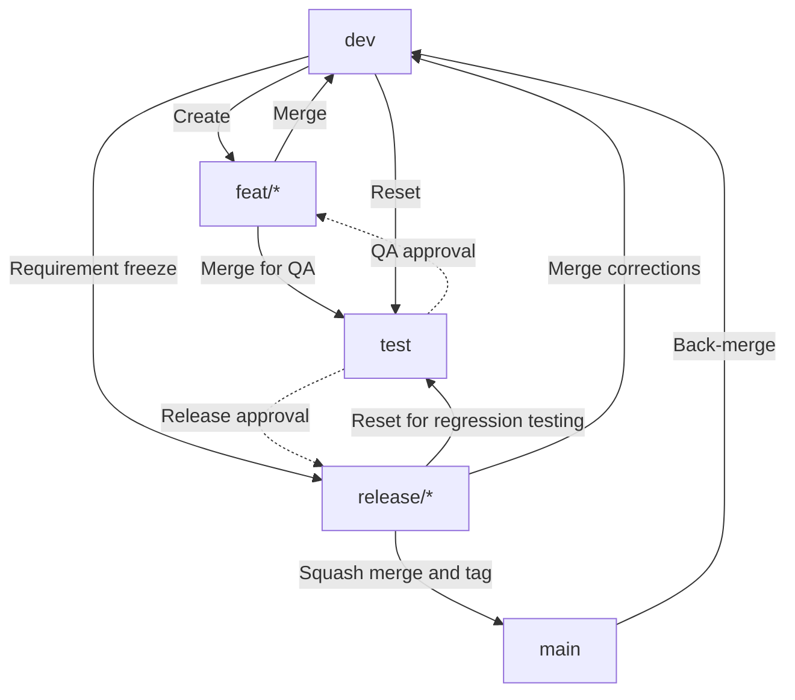
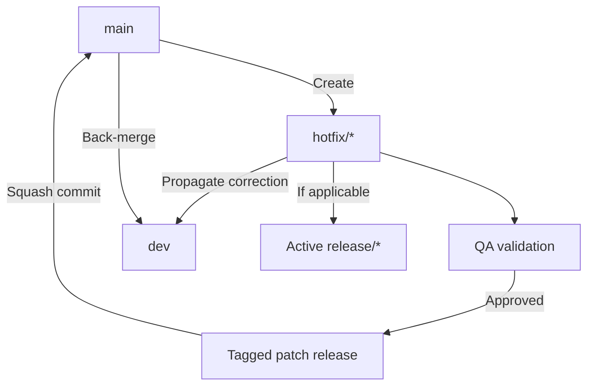

# Git Flow Specification

## 1. Overview

### 1.1. Definition

This specification defines a development-centric Git branching model with isolated feature validation, release stabilization, and versioned production history.

The model comprises three principal branches and three supporting branch categories:

- `dev`: Primary development branch.
- `main`: Production release branch.
- `test`: Resettable quality assurance branch.
- `feat/*`: Feature development branches.
- `release/*`: Release stabilization branches.
- `hotfix/*`: Corrective branches.

`dev` is the authoritative development branch and retains the complete integration history.

`main` represents the production release history. Each commit on `main` corresponds to exactly one version tag. Changes are incorporated through squash merges, preserving one commit per released version.

`test` represents a temporary validation state. It is derived from `dev` for feature validation and from `release/*` for release validation.

### 1.2. Branch Structure

The branching model distinguishes development, validation, and production states.

| State | Branch | Function |
| --- | --- | --- |
| Development | `dev` | Integration of approved changes |
| Feature Development | `feat/*` | Independent implementation |
| Feature Validation | `test` | Validation before integration |
| Release Stabilization | `release/*` | Stabilization of a fixed release scope |
| Release Validation | `test` | Validation of a release candidate |
| Production | `main` | Versioned production history |
| Correction | `hotfix/*` | Correction of defects in an existing branch state |

### 1.3. Branch Naming Convention

Supporting branches shall follow the format:

`<user>@<type>/<identifier>`

Where:

- `user`: Identifier of the branch creator.
- `type`: Branch classification.
- `identifier`: Feature, release version, or defect identifier.

| Branch Type | Pattern | Example |
| --- | --- | --- |
| Development | `dev` | `dev` |
| Production | `main` | `main` |
| Validation | `test` | `test` |
| Feature | `<user>@feat/<identifier>` | `alice@feat/authentication` |
| Release | `<user>@release/v<major>.<minor>.<patch>` | `alice@release/v1.2.0` |
| Hotfix | `<user>@hotfix/<identifier>` | `alice@hotfix/session-expiry` |

Version tags shall follow semantic versioning:

`v<major>.<minor>.<patch>`

Each production commit shall have exactly one corresponding release version tag.

---

## 2. Branching Model

### 2.1. Branch Classification

Branches are classified according to their lifecycle and operational function.

**Long-Lived Branches**

`dev` and `main` are permanent branches.

**Temporary Branches**

`test` is a resettable branch whose state is determined by the current validation target.

**Supporting Branches**

`feat/*`, `release/*`, and `hotfix/*` are short-lived branches created for specific development, stabilization, or corrective operations.

### 2.2. Branch Derivation and Integration Rules

The following table defines permitted derivation and integration operations.

| Source | Target | Operation |
| --- | --- | --- |
| `dev` | `feat/*` | Branch creation |
| `dev` | `test` | Branch initialization or reset |
| `feat/*` | `test` | Non-fast-forward merge |
| `feat/*` | `dev` | Non-fast-forward merge after QA approval |
| `dev` | `release/*` | Branch creation |
| `release/*` | `test` | Reset for release validation |
| `release/*` | `main` | Squash merge |
| `release/*` | `dev` | Non-fast-forward merge |
| `main` | `dev` | Non-fast-forward merge after release |
| `main` | `hotfix/*` | Branch creation for production correction |
| `release/*` | `hotfix/*` | Branch creation for release correction |
| `hotfix/*` | Origin and affected branches | Merge according to correction scope |

The following constraints apply:

1. `dev` shall not be merged directly into `main`.
2. `main` shall accept changes only through a versioned squash release operation.
3. Supporting branches shall not be merged into `main` without an associated release tag.
4. `test` shall not be merged into `dev`, `release/*`, or `main`.
5. All development changes shall be integrated into `dev` before inclusion in a normal release.
6. Corrections introduced during release stabilization shall be propagated to `dev`.
7. After a production release, `main` shall be merged into `dev` to establish the released commit as part of the development ancestry.

### 2.3. Hotfix Rules

A hotfix branch may be derived from either `main` or an active `release/*` branch.

#### 2.3.1. Production Hotfix

A production hotfix shall be derived from `main`.

The corrected state shall undergo validation and be integrated into `main` through a squash merge with a new patch-version tag.

The original corrective commits shall then be propagated to `dev` and any active `release/*` branch to which the correction applies. The new `main` commit shall subsequently be synchronized into `dev`.

#### 2.3.2. Release Hotfix

A release hotfix shall be derived from the affected `release/*` branch.

The correction shall be merged into its originating release branch and propagated to `dev`.

The corrected release candidate shall undergo validation before publication.

A release hotfix shall not modify `main` independently of a formal release operation.

#### 2.3.3. Hotfix Integration

Hotfix integration shall satisfy the following conditions:

1. A correction shall be applied to its originating branch.
2. The correction shall be propagated to every active branch whose code state requires it.
3. A production correction shall receive a distinct version tag.
4. A corrective branch shall be deleted after all required integrations are completed.

Defects confined to unreleased features shall be corrected on the corresponding `feat/*` branch rather than through a production hotfix.

### 2.4. Long-Lived Branches

#### 2.4.1. `dev`

`dev` is the primary development branch.

It maintains the complete development and integration history, including approved features, release corrections, and propagated production hotfixes.

All normal release branches shall originate from `dev`.

`dev` shall preserve its existing commit history. Integrated changes shall not be removed through history rewriting.

#### 2.4.2. `main`

`main` is the production release branch.

Each commit represents one released version and shall be associated with exactly one semantic version tag.

The branch shall maintain a linear commit history.

Normal feature, development, and release histories shall not be incorporated directly. Each release shall be represented by a single squash commit.

Direct development commits and unversioned merge commits on `main` are prohibited.

### 2.5. Temporary Branches

#### 2.5.1. `test`

`test` represents the current quality assurance state.

It may be initialized from either:

- `dev`, for feature validation.
- `release/*`, for release validation.

During feature validation, unapproved feature branches may be merged into `test` without affecting `dev`.

After validation and integration, `test` shall be reset to the updated `dev` state.

During release validation, `test` shall be reset to the selected `release/*` commit.

The existing `test` history is not authoritative and may be discarded. Reset operations shall not occur while an active validation session depends on that state.

### 2.6. Supporting Branches

#### 2.6.1. `feat/*`

Feature branches shall originate from `dev`.

Each feature branch represents an independent development scope.

A feature shall be validated on `test` before integration into `dev`.

Corrections identified during feature validation shall be committed to the originating feature branch.

The feature branch shall be deleted after successful integration.

#### 2.6.2. `release/*`

Release branches shall originate from `dev`.

Each release branch establishes a fixed scope for one production version.

After creation, the release branch shall accept only changes required for release stabilization, including defect corrections, version metadata, and release-specific adjustments.

New feature development shall continue on `dev`.

The release branch shall be deleted after publication and propagation of its changes.

#### 2.6.3. `hotfix/*`

Hotfix branches shall originate from the affected production or release state.

Each hotfix branch shall address a defined corrective scope.

A hotfix branch shall be deleted after validation and integration into all required target branches.

---

## 3. Development Flow

### 3.1. Feature Development

Feature development shall begin from the current `dev` state.

A developer shall create a dedicated `feat/*` branch and commit implementation changes to that branch.

Multiple feature branches may be developed concurrently.

A feature branch shall remain independent of `dev` integration until its validation requirements are satisfied.

### 3.2. Feature Testing

A feature shall be merged into `test` for quality assurance.

The merge shall preserve the feature's development commits.

If validation fails, corrections shall be committed to the original feature branch and subsequently merged into `test` for further testing.

After successful validation, the feature branch shall be merged into `dev` through a non-fast-forward merge.

Following integration, `test` shall be reset to the updated `dev` state when no active validation session requires the previous state.

Approval of one feature shall not imply approval of other unintegrated features present on `test`.

### 3.3. Requirement Freeze

A release scope shall be established by creating a `release/*` branch from a selected `dev` commit.

The creation of this branch constitutes the requirement freeze for the corresponding version.

Subsequent changes to `dev` shall not be incorporated automatically into the release branch.

Only changes required to stabilize the selected release scope may be integrated.

Feature development for later versions may continue independently on `dev`.

### 3.4. Pre-Release Preparation

The release branch shall contain all changes intended for the corresponding production version.

Release-specific defects shall be corrected on the release branch or through a derived hotfix branch.

Any corrective changes introduced during stabilization shall be propagated to `dev`.

The release candidate shall be identified by a specific commit on `release/*`.

### 3.5. Pre-Release Testing

`test` shall be reset to the selected release candidate commit.

The resulting validation state shall correspond to the release candidate without additional unapproved feature changes.

Validation shall include the required integration and regression tests.

If defects are identified, the release branch shall be corrected and a new candidate shall be deployed to `test`.

This process shall continue until the release candidate satisfies the acceptance criteria.

The final validated commit shall be used as the production release source.

### 3.6. Release Confirmation

After release approval, the validated `release/*` state shall be squash-merged into `main`.

The resulting commit shall be assigned the release version tag.

No additional commit shall be introduced on `main` for the same release.

Following publication:

1. The original `release/*` commits shall be merged into `dev`.
2. The newly created `main` release commit shall be merged into `dev`.
3. The release branch shall be deleted.
4. `test` may be reset to the current `dev` state.

The release-to-development synchronization establishes the production commit as part of the `dev` ancestry while retaining the original development commits.

This synchronization does not eliminate the possibility of future merge conflicts.

---

## 4. Workflow Diagrams

### 4.1. Branch Lifecycle



### 4.2. Production Hotfix



### 4.3. Release Commit History

```text
main:

A -------- S1 -------- S2 -------- S3
|          |           |           |
v0.0.0     v1.0.0      v1.1.0      v1.2.0


dev:

A --- B --- C --- M1 --- D --- E --- M2
 \               /          \       /
  S1 -----------'            S2 ---'

```

`B`, `C`, `D`, and `E` represent development commits.

`S1` and `S2` represent squash-generated production commits.

`M1` and `M2` represent synchronization merges from `main` into `dev`.

The diagram abstracts intermediate feature and release merge commits.

Production version tags are assigned exclusively to the corresponding commits on `main`.

---

## 5. Branch Commands and Examples

The following commands illustrate the required branch operations. Operations on protected branches shall be executed through the corresponding approved integration process.

### 5.1. Feature Branch Creation

```bash
git switch dev
git pull origin dev

git switch -c alice@feat/authentication
git push -u origin alice@feat/authentication
```

### 5.2. Feature Validation

```bash
git switch test
git pull origin test

git merge --no-ff alice@feat/authentication
git push origin test
```

If corrections are required:

```bash
git switch alice@feat/authentication

# Apply corrections
git add .
git commit -m "fix(auth): correct authentication"
git push origin alice@feat/authentication

git switch test
git merge --no-ff alice@feat/authentication
git push origin test
```

### 5.3. Feature Integration

```bash
git switch dev
git pull origin dev

git merge --no-ff alice@feat/authentication
git push origin dev
```

After successful integration:

```bash
git branch -d alice@feat/authentication
git push origin --delete alice@feat/authentication
```

### 5.4. Test Branch Reset

When no validation session depends on the current `test` state:

```bash
git fetch origin

git switch dev
git pull origin dev

git switch -C test dev
git push --force-with-lease origin test
```

This operation replaces the remote `test` state with the current `dev` state.

### 5.5. Release Branch Creation

```bash
git switch dev
git pull origin dev

git switch -c alice@release/v1.2.0
git push -u origin alice@release/v1.2.0
```

The release scope is fixed at the selected `dev` commit.

### 5.6. Release Validation

Reset `test` to the selected release candidate:

```bash
git fetch origin

git switch -C test alice@release/v1.2.0
git push --force-with-lease origin test
```

Following a release correction, the release candidate shall be validated again.

### 5.7. Production Release

After release approval:

```bash
git switch main
git pull origin main

git merge --squash alice@release/v1.2.0
git commit -m "release: v1.2.0"

git tag -a v1.2.0 -m "Release v1.2.0"
git push origin main v1.2.0
```

The squash operation shall produce one production commit for the approved release.

### 5.8. Post-Release Synchronization

First, integrate release-specific changes into `dev`:

```bash
git switch dev
git pull origin dev

git merge --no-ff alice@release/v1.2.0
```

Then incorporate the production release commit into the development ancestry:

```bash
git fetch origin main
git merge --no-ff origin/main

git push origin dev
```

Any merge conflicts shall be resolved before completing the synchronization.

After successful synchronization:

```bash
git branch -d alice@release/v1.2.0
git push origin --delete alice@release/v1.2.0
```

### 5.9. Production Hotfix

Create a hotfix branch from `main`:

```bash
git switch main
git pull origin main

git switch -c alice@hotfix/session-expiry
```

Apply and commit the correction:

```bash
git add .
git commit -m "fix(session): correct session expiry"
git push -u origin alice@hotfix/session-expiry
```

After validation, publish the corrected production state:

```bash
git switch main
git pull origin main

git merge --squash alice@hotfix/session-expiry
git commit -m "release: v1.2.1"

git tag -a v1.2.1 -m "Release v1.2.1"
git push origin main v1.2.1
```

Propagate the original correction and synchronize the production commit:

```bash
git switch dev
git pull origin dev

git merge --no-ff alice@hotfix/session-expiry
git fetch origin main
git merge --no-ff origin/main

git push origin dev
```

If an active release branch requires the correction, merge the hotfix into that branch and repeat release validation.

### 5.10. Branch and Version Inspection

Inspect the development history:

```bash
git log dev --graph --oneline --decorate
```

Inspect the production history:

```bash
git log main --first-parent --oneline --decorate
```

Inspect release tags:

```bash
git tag --list "v*"
```

Verify the production history is linear:

```bash
git rev-list --min-parents=2 main
```

The final command shall return no commits.

### 5.11. Integration Summary

| Operation | Source | Target | Method |
| --- | --- | --- | --- |
| Feature validation | `feat/*` | `test` | Merge |
| Feature integration | `feat/*` | `dev` | Merge |
| Test synchronization | `dev` | `test` | Reset |
| Release creation | `dev` | `release/*` | Branch |
| Release validation | `release/*` | `test` | Reset |
| Production publication | `release/*` | `main` | Squash + Tag |
| Release correction propagation | `release/*` | `dev` | Merge |
| Production synchronization | `main` | `dev` | Merge |
| Production hotfix publication | `hotfix/*` | `main` | Squash + Tag |
| Hotfix propagation | `hotfix/*` | `dev`, affected `release/*` | Merge |

The principal invariant is that `dev` retains the complete development history, whereas `main` retains a linear sequence of uniquely tagged production release commits.
